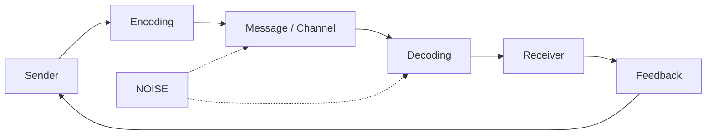

# Communication Process and the Value of Feedback in Organisations

## Introduction

Many problems at work get blamed on laziness or poor skill when they are really communication problems. A manager believes she gave a clear instruction, the employee understood something slightly different, and two weeks later both are frustrated. This assignment outlines how communication works, where it tends to break down, and why feedback matters so much to organisations today. Examples are drawn from Toyota, Pixar and Adobe.

## 1. The Communication Process

Communication is a loop, not a one-way push. The sender has an idea and puts it into words, tone or gesture (encoding). The message travels through a channel such as a meeting, email, call or chat. The receiver then makes sense of it (decoding) and reacts. Along the way, noise can distort the message: vague wording, a loud workshop floor, cultural differences, or simply the receiver's mood.

Take a simple case. A team lead messages, "Send the report soon." She means by evening, but the analyst reads it as by the end of the week. The wording was vague, a quick chat message carried no tone, and nobody checked. A one-line reply such as "Do you mean today?" would have fixed it. That reply is feedback, which is why the arrow in the diagram runs back to the sender.

## 2. Why Feedback Matters Today

Many teams now work from different cities and rarely share a room. Instructions pass through email, video calls and messaging apps, where facial expressions are missing and misreading is easy. Feedback is the fastest way to find out whether a message actually landed. It does a few specific jobs:

- **It confirms understanding.** A short reply or a repeated-back summary shows whether the receiver got what the sender meant.
- **It catches mistakes early.** An error noticed on day one costs far less than one found at delivery.
- **It helps people improve.** Employees who hear regularly how they are doing can correct course instead of guessing.
- **It gives leaders a true picture.** If bosses only hear good news, they decide on false information.
- **It builds trust.** When people see their comments lead to change, they keep speaking up.

## 3. Organisations That Show This in Practice

**Toyota.** On Toyota's assembly lines, any worker who spots a defect can pull a cord called the andon, and the line can be stopped so the problem is fixed on the spot. The person closest to the work gives feedback immediately, instead of a faulty car travelling to the end of the line. Many manufacturers have since copied the practice.

**Pixar.** Pixar holds Braintrust meetings where directors show unfinished films to colleagues who give frank opinions. Ed Catmull, a co-founder, has written that these sessions helped the studio solve story problems before release. The comments are advice, not orders, so the director stays in charge. That keeps the feedback honest without making it feel like an attack.

**Adobe.** In 2012 Adobe dropped its yearly performance review and replaced it with ongoing "Check-in" conversations between managers and employees. Waiting twelve months to tell someone how they were doing no longer made sense. The company reported that fewer people left voluntarily afterwards.

In each case, feedback was quick, came from the people nearest the work, and was acted upon.

## Conclusion

Communication is only complete when the sender knows what the receiver actually understood, and feedback is what closes that gap. Toyota, Pixar and Adobe differ in size and industry, but each made speaking up easy and responding to it normal. For any organisation, a sensible first step is a small one: ask "what did you take from that?" more often, and listen to the answer.

---
